# UniEat Android — Sprint 3, Samuel David Rozen Mogollon

BQ-13 (cache pilot) and the connectivity, storage, threading and caching strategies of my slice. Every claim below points to the file where it lives. Code: branch [`feat/samuel-bq13-cache-pilot`](https://github.com/cmolina12/UniEat-Android/tree/feat/samuel-bq13-cache-pilot), issue [#50](https://github.com/cmolina12/UniEat-Android/issues/50).

## 1. Features I deliver (Sprint 2 + Sprint 3)

| Feature | Sprint | Where |
|---|---|---|
| Supabase login, persisted session with token refresh (Proxy) | 2 | `data/auth/SessionManager.kt`, `ui/auth/LoginViewModel.kt` |
| Profile from `GET /me`, tabs by role | 2 | `ui/auth/ProfileViewModel.kt`, `ui/navigation/AppShellViewModel.kt` |
| Shake-to-refresh (accelerometer) | 2 | `data/sensor/ShakeRefreshController.kt` |
| "Menor fila" recommendation criterion | 2 | `ui/feed/RecommendationStrategy.kt` |
| BQ-01 feed-load telemetry, upload and admin card | 2 | `data/telemetry/` |
| **BQ-13 cache pilot**: opt-in in Perfil, two feed cache policies, one record per visit, upload, admin card | **3** | `data/pilot/`, `data/repository/FeedCachePolicy.kt`, `ui/profile/CachePilotSection.kt` |
| **24 h TTL for the saved feed** | **3** | `data/repository/FeedCachePolicy.kt` |
| **Login and sign-up aware of connectivity** | **3** | `ui/auth/LoginViewModel.kt`, `ui/auth/AuthScreens.kt` |

## 2. BQ-13 — Connectivity and Cache Evaluation

| Field | Value |
|---|---|
| **Question** (Sprint 1 §6.5, unchanged) | In a controlled pilot, how do feed-rendering time and the share of sessions ending without a menu selection differ between cache-enabled and online-only variants under comparable connection conditions? |
| **Author** | Samuel David Rozen Mogollon |
| **Type** | **Type 5 (Type\*)**: Type 1, diagnose how the feed loads (time until menus are on screen, technical outcome); Type 3, decide whether to keep or revise the local cache (does it change whether students end up choosing?). |
| **Rationale** | The feed cache costs storage, code and the risk of showing stale data. BQ-01 tells us *where* the feed is slow; BQ-13 tells us whether the cache is what makes the difference, measured on the decision the app exists for. It is different from my Sprint 2 BQ-01 and comes from the Sprint 1 list (PAS-09). |

### How the pilot works

```mermaid
flowchart LR
    P[Perfil: student opts in] --> E[(DataStore unieat_settings<br/>cache_pilot_user_id)]
    E --> V["PilotVariant.assign(userId)<br/>md5 bit, 50/50, stable"]
    V --> S{FeedCachePolicy}
    S -- cache_enabled --> C[CacheThenNetwork<br/>copy at once, network replaces it]
    S -- online_only --> N[NetworkOnly<br/>always waits for the server]
    C & N --> F[FeedScreen draws menus]
    F --> R["CachePilot (Mutex)<br/>first load of the visit"]
    D[Detail: Elegir este menú] -- PilotEventTracker --> R
    R --> DB[(Room cache_pilot_sessions)]
    DB -- ended visits --> W[WorkManager<br/>network required]
    W --> API[POST /telemetry/cache-pilot]
    API --> T[(Postgres cache_pilot_sessions)]
    T --> Q[cache_pilot_summary<br/>percentile_disc]
    Q --> G[GET /telemetry/cache-pilot/summary]
    G --> CARD[BQ-13 card in Rendimiento]
    DB -. server unreachable .-> CARD
```

- **Consent.** Nobody is in the pilot until they turn it on in Perfil. The card says what is recorded (load time, connection type, whether a copy existed, whether a menu was chosen) and what is not (location, which menu). Leaving restores the cache at once and deletes the visits not sent yet. Signing out also clears it.
- **Assignment.** `PilotVariant.assign` takes the lowest bit of `md5("bq13-v1:" + userId)`. It is 50/50, cannot be re-rolled by leaving and re-joining, and the server computes the same group (`cache_pilot_variant` in SQL) to reject a visit that claims the other one.
- **What differs between groups.** Only how the saved feed is used (`FeedCachePolicy`). Both groups keep saving the feed, both get the same ranking, the same filters and the same screens. "Elige por mí" follows the same policy but does not open pilot visits.
- **Unit of analysis: a visit.** It starts with the first feed load on "Hoy" and ends after 30 minutes without feed activity or analytics events, on the next app launch, when the group changes or when the student leaves the pilot. Only ended visits are counted.
- **Measured per visit** (first load only, when the cache matters most): connection type, whether an eligible copy existed and its age, load start → first menus on screen (and their source), load start → fresh network menus, technical outcome (`network`, `cache_only`, `failure`, `abandoned`), and whether "Elegir este menú" was tapped.
- **Answer.** Groups are compared only inside the same connection type and the same "copy existed" condition. The card shows visits, visits that saw menus, median and p95 time to menus (nearest rank, same definition as BQ-01 and PostgreSQL `percentile_disc`), and visits that ended without a selection, as a share from five visits per group.

**Limits.** Five visits is a display threshold, not statistical significance. Opt-in students are not a random sample of all students; the comparison is between groups of volunteers. A selection is not a purchase. Repeated visits by the same student are not independent. The card never fills an empty group with sample numbers.

### Backend (shared Supabase project)

Migration `20261031000000_bq13_cache_pilot.sql`: table `cache_pilot_sessions` with RLS and check constraints (for example, an online-only visit can never report a cache source), `cache_pilot_variant(uuid)` and `cache_pilot_summary(days)`. Handler `handlers/cache-pilot.ts`: per-row validation (a bad row is rejected alone), group check against the server assignment, idempotent insert by `session_id`, admin-only summary for 7 or 28 days. Until it is deployed, uploads wait in Room and the card shows this device only, labelled as such.

## 3. Eventual connectivity

| Scenario | Strategy | Behavior |
|---|---|---|
| Login / sign-up without signal | Network only, explained before sending | `LoginViewModel` observes `ConnectivityMonitor`. Offline, the button is disabled and a notice says that signing in needs signal; what was typed stays; field errors are still shown; nothing is sent (no 10 s timeout). When the signal returns, the notice and the error disappear by themselves. Demo entry keeps working. |
| Opening "Hoy" offline, cache-enabled group or outside the pilot | Cache then network, falling back to cache | Saved copy at once with "Sin conexión · menús guardados a las HH:MM"; the request replaces it when it answers. |
| A saved copy older than 24 h | TTL | The copy is not eligible: the screen says "Sin conexión" instead of an empty list that would read as "no menus match your filters". |
| Opening "Hoy" offline, online-only group | Network only, with a way out | An explicit message: the student is in the online-only group, saved menus are not used, and leaving the pilot in Perfil brings them back. |
| A pilot visit ends while offline | Queue and retry | The visit stays in Room; `WorkManagerCachePilotScheduler` runs only with network and retries with exponential backoff (30 s). The server ignores repeated `session_id`, so a resent batch never counts twice. |
| BQ-13 card, server unreachable or endpoint not deployed | Network falling back to local data | `RemoteCachePilotRepository.summary` answers with this device's visits and the card says "Solo este dispositivo". |
| Joining or leaving the pilot offline | Local only | Consent is a DataStore key; it needs no request. |
| BQ-01 (Sprint 2, unchanged) | Queue and retry + local fallback | Same pattern as above. |

## 4. Local storage

| Kind | What | Why this kind | Where |
|---|---|---|---|
| **Relational (Room)** | Table `cache_pilot_sessions`, one row per visit; database version 1 → 2 with `MIGRATION_1_2` | Each visit is updated in place several times (draw, failure, selection, close, upload) and queried by state ("ended and not sent", "started after X"). A table with a primary key does that with one statement; a JSON file would be rewritten whole each time. The migration keeps Camilo's pending reports on phones that had version 1. | `data/pilot/CachePilotSession.kt`, `data/local/UniEatDatabase.kt` |
| **Preferences (DataStore)** | `cache_pilot_user_id` in the shared `unieat_settings` file | A yes/no consent is one key-value pair; it is read on every feed load and must survive restarts. The group is not stored: it is recomputed from the user id. An unreadable file reads as "not enrolled". | `data/pilot/CachePilot.kt` (`DataStorePilotEnrollment`) |
| Files (Sprint 2) | BQ-01 load records | Append-only log | `data/telemetry/FeedLoadTelemetry.kt` |
| Preferences (Sprint 2) | Supabase session (`unieat_session`) | Four values; not encrypted at rest, a known limitation | `data/auth/SessionStore.kt` |

Privacy: no location or menu ids are stored for the pilot, and everything is deleted on sign-out (`AppContainer`).

## 5. Multithreading

| Strategy | Where | Why |
|---|---|---|
| **Mutex (mutual exclusion) over a shared visit** | `CachePilot`: every public method runs inside `mutex.withLock` | The feed (Main), the event tracker (IO, app scope) and the upload worker (WorkManager thread) all update the same row. Without the lock two callers could read the old row and the second write would erase the first change. `kotlinx` Mutex is fair, so start → draw → failure are applied in call order. |
| **Coroutines with dispatchers: Main → IO** | `CachePilot.save` uses `withContext(io)`; `FeedViewModel` reads the clock on Main and launches the pilot call | Room runs on IO; the screen never waits for it. The pilot call is launched, not awaited, so recording does not delay the saved copy, which is exactly the time BQ-13 measures. |
| **Background worker** | `CachePilotUploadWorker` (`CoroutineWorker`) | The upload runs off the main thread, outside any screen, and survives the app closing. |
| **Local work at launch on IO, network work deferred** | `AppContainer.startCachePilot` | Ending the previous launch's visits needs no network, so it runs at once on IO; only the upload waits for WorkManager. Doing both in the worker left visits open while an upload was in retry backoff. |
| **Parallel child coroutines** | `PerformanceViewModel.load`: a fifth `async` for BQ-13 next to Camilo's four | The dashboard waits for the slowest request, not the sum. |
| Mutex for token refresh (Sprint 2) | `SessionManager` | Ten parallel requests cause one refresh. |

## 6. Caching

| Strategy | Where | Parameters and invalidation |
|---|---|---|
| **Two interchangeable feed cache policies** (Strategy pattern) | `data/repository/FeedCachePolicy.kt`, used in `FeedViewModel.fetch` | `CacheThenNetwork`: copy while loading and when offline. `NetworkOnly`: never. Outside the pilot, `CacheThenNetwork`. |
| **TTL for the saved feed** | `FeedCachePolicy.MAX_COPY_AGE` = 24 h | A publication lasts 24 h at most, so an older copy can only hold expired menus. Measured on the phone clock (same clock that saved it), never negative. |
| **Write-through record of the current visit** | `CachePilot.current` + Room | The visit is kept in memory for speed and written to Room on every change, so it survives the process dying. |

## 7. Patterns and architecture

| Pattern / style | Where | What it solves |
|---|---|---|
| **Strategy** | `FeedCachePolicy` (`CacheThenNetwork`, `NetworkOnly`) | `FeedViewModel` has no `if (group)`; a third policy would be one more object. |
| **Decorator** | `PilotEventTracker` wraps `QueuedEventTracker` in `AppContainer` | The selection is tracked by the detail screen; the decorator adds the pilot notification without editing any screen, and every event still reaches the analytics queue unchanged. |
| **Repository** | `CachePilotRepository` with `Remote` and `Local` implementations | ViewModels and the worker never see HTTP; demo mode swaps the implementation. |
| **Observer** | `LoginViewModel.offline` (`StateFlow`) fed by `ConnectivityMonitor.online` | The screen re-renders when connectivity changes. |
| **Proxy** (Sprint 2) | `SessionManager` behind `AccessTokenProvider` | Token lifecycle hidden from repositories. |
| **MVVM** | Every screen of the slice | Business decisions in ViewModels and plain Kotlin, tested on the JVM. |
| **Layered architecture** | UI → ViewModel → Repository / pilot → Room, DataStore, Ktor | Each layer only knows the one below. |
| **Interface segregation** | `CachePilot` implements `FeedPilot` (for the feed) and `PilotMembership` (for Perfil) | Each ViewModel depends only on what it uses and is tested with a small fake. |
| **Manual dependency injection** | `AppContainer` | One instance of each piece; factories read from it. |

## 8. Tests

`./gradlew :app:testDebugUnitTest` runs them on the JVM:

| Suite | What it proves |
|---|---|
| `CachePilotTest` (15) | MD5 assignment and its reference values, opt-in per account, cache-first and network metrics, only the first load counts, failures, selection and 30-minute idle rule, previous-launch visits end as abandoned, leaving and sign-out, local report |
| `CachePilotReportTest` (5) | Nearest rank, grouping by connection and copy, times ignore visits without menus, five-visit threshold, open visits not counted |
| `CachePilotSyncTest` (8) | Batches, offline retry, endpoint not deployed, invalid batch skipped, previous-launch visits sent, API contract, summary decoding, local fallback |
| `FeedCachePilotTest` (10) | Both policies, offline message per group, 24 h TTL, what the pilot is told, "Elige por mí" opens no visits |
| `PilotEventTrackerTest` (1) | Decorator forwards every event |
| `LoginOfflineTest` (3) | Nothing sent offline, field errors still shown, recovers when signal returns |
| `CachePilotViewModelTest` (3) | Join/leave, double tap, signed out |
| `PerformanceCachePilotTest` (3) | Admins only, same period, failure keeps the dashboard |

Not covered by unit tests: the Room migration on a real database and the Compose screens. Both were checked by hand on an Android 15 emulator (Pixel 8) against the shared Supabase project: the build from `main` with a report waiting offline, then this branch installed on top. A run on a physical device is still pending.
