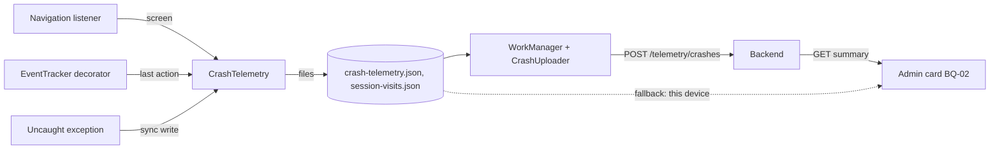

# UniEat Android — Sprint 4, Samuel David Rozen Mogollon

My slice for the last sprint: one micro-optimization measured with a profiler, the "Guardados" view with the local-storage feature, BQ-02, and the connectivity, storage, threading and caching strategies. Every claim points to the file where it lives.

## 1. Features I deliver (Sprints 2, 3 and 4)

| Feature | Sprint | Where |
|---|---|---|
| Supabase login, persisted session with token refresh (Proxy) | 2 | `data/auth/SessionManager.kt`, `ui/auth/LoginViewModel.kt` |
| Profile from `GET /me`, tabs by role | 2 | `ui/auth/ProfileViewModel.kt`, `ui/navigation/AppShellViewModel.kt` |
| Shake-to-refresh (accelerometer) | 2 | `data/sensor/ShakeRefreshController.kt` |
| "Menor fila" recommendation criterion | 2 | `ui/feed/RecommendationStrategy.kt` |
| BQ-01 feed-load telemetry, upload and admin card | 2 | `data/telemetry/` |
| BQ-13 cache pilot, 24 h TTL for the saved feed, login aware of connectivity | 3 | `data/pilot/`, `data/repository/FeedCachePolicy.kt`, `ui/auth/` |
| **"Menús guardados" view: save a menu, list it offline, remove it (Android counterpart of the iOS saved menus)** | **4** | `data/saved/`, `ui/saved/` |
| **BQ-02 crash telemetry, upload and admin card** | **4** | `data/telemetry/CrashTelemetry.kt`, `CrashUpload.kt`, `ui/performance/PerformanceScreen.kt` |
| **Micro-optimization: BQ-01 records decoded once per process; saved-feed lookup stops at the newest match** | **4** | `data/telemetry/FeedLoadTelemetry.kt`, `data/repository/FeedCache.kt` |

## 2. Value proposition: what the app delivers

*(Team text to agree on with Camilo and Juan José; this is the Android evidence for it.)* UniEat answers one question for a student with little time and a budget: **what can I eat now, near me, that is still available?** What the Android app delivers today:

- a feed of menus that are valid *right now*, judged with the server clock, ranked by the backend and filtered by budget, diet, area, payment and available minutes (Juan José);
- for the menu the student picks: location with pin, entrance, walking distance and reports of changes (Camilo);
- an estimated wait per menu (BQ-06) and a recommendation with its reason;
- it keeps working with poor or no signal: the last feed is shown with its saved time, reports and telemetry wait in a queue and are sent later;
- **Sprint 4:** the student can keep the menus they are considering ("Menús guardados") and open the list without signal, so deciding does not depend on the connection at the moment of choosing.

What is *not* delivered, so the proposition is not overstated: menus come only from establishments that publish them, and wait times are estimates from reports, not measurements.

## 3. New view and business question (viva voce)

### 3.1 View: "Menús guardados" (feature: local storage)

Reached from **Perfil → Ver mis menús guardados**; saved from the **detail** with "Guardar este menú" (toggle). It is the Android counterpart of the iOS saved menus (Kevin, Sprint 2) and sends the same `menu_save` event. It does not replace Juan José's Favoritos: the heart in the detail saves the *restaurant*, this button saves *today's menu*. Each row shows establishment, title, lowest price, area, "Hasta HH:MM" or "Posiblemente vencido", and when it was saved. Tapping opens the detail (which uses the saved feed copy if there is no signal).

### 3.2 Business question: BQ-02 — Crashes by Screen and Action

| Field | Value |
|---|---|
| **Question** (Sprint 1 §6.1, unchanged) | Over the last seven days, which screens and preceding actions had the highest crash rates per 1,000 sessions visiting those screens, segmented by device model, OS version, and app version? |
| **Author** | Sprint 1 proposal (additional question extending the telemetry concerns of MS4); implemented by Samuel David Rozen Mogollon |
| **Type** | **Type 1, app telemetry** |
| **Rationale** | BQ-01 tells us where the feed is slow; BQ-02 tells us where the app *stops*. A crash on the detail after "selection" costs the one decision the app exists for. A rate per 1,000 sessions *that visited the screen* (not per crash) stops a popular screen from looking worse only because more people use it. |

How it works:

- **Last screen:** an `OnDestinationChangedListener` in `UniEatNavHost` calls `CrashTelemetry.onScreen`.
- **Preceding action:** the existing event tracker is decorated (`AppContainer.eventTracker`); the last tracked event (`selection`, `location_open`…) is the action; opening a screen resets it to `screen_open`.
- **Denominator:** each session saves the screens it visited; the rate for a group is `crashes × 1000 / sessions that visited that screen on the same device model, Android and app version`, never with fewer sessions than crashes.
- **Privacy:** no stack trace or message is stored, only the exception class.
- **Debug only:** the card has a "Simular fallo" button in debug builds to show the record in the demo.

### Backend contract (the backend repo is not in this repository)

`POST /telemetry/crashes` body `{ "platform": "android", "crashes": [CrashRecord], "sessions": [SessionVisitRecord] }`, idempotent by `crashId` and `sessionId`, answer `{ "accepted": n, "duplicates": n }`. `GET /telemetry/crashes/summary?days=7` (admin) returns `CrashReport` (`periodDays`, `crashes`, `sessions`, `groups[]`). Field names are in `CrashTelemetry.kt`. Until it is deployed, uploads wait on the phone and the card shows this device only, labelled as such.

## 4. Micro-optimization with profiler

| | |
|---|---|
| **Scenario** | Opening "Hoy" repeatedly (each open writes BQ-01 records) and opening a menu detail without signal (looks the menu up in the saved feeds). |
| **Problem found by reading the code** | `FeedLoadTelemetry` read and decoded the whole JSON file, and rewrote it, on every operation (append, render, upload check, mark as sent). `FileFeedCache.findMenu` decoded every saved feed file, newest or not, until it found the menu. |
| **Change** | Decode once per process and keep the list in memory (writes still go to disk first, the cache is updated after a successful write). `findMenu` sorts by newest, skips files whose text does not contain the menu id, and stops at the first match. |
| **Why it is safe** | Only `FeedLoadTelemetry` writes that file and every access holds the same `Mutex`; the cache is replaced, never mutated. Tests: `FileFeedCacheTest` (newest wins, skips files without the menu). |

### Evidence (to fill with real numbers)

Measure **before** on `main` and **after** on `feat/samuel-sprint4`, same device, same scenario, release-like conditions (profileable build or debug with the profiler's CPU trace), 5 runs each, median.

1. Android Studio → **Profiler** → *Find CPU Hotspots* (or *Capture System Activities*), record the scenario, and filter by `FeedLoadTelemetry` / `findMenu`.
2. Note total time of `readFile`/`decodeFromString` and the number of calls during 20 opens of "Hoy".
3. Repeat with the saved feed folder holding 10+ files for `findMenu`.

| Metric | Before (`main`) | After | Change |
|---|---|---|---|
| `FeedLoadTelemetry` file decodes in 20 opens | | | |
| CPU time in `FeedLoadTelemetry` (ms) | | | |
| `findMenu` with 10 saved feeds (ms, median of 5) | | | |
| Device and Android version | | | |

Screenshots of both traces go next to the table. The numbers are not filled in here because they have to come from the phone.

## 5. Eventual connectivity

| Scenario | Strategy | Behavior |
|---|---|---|
| Save / remove a menu, open "Menús guardados" without signal | Local only | Everything is in Room; no request exists, so there is nothing to queue. The list shows a notice "Sin conexión · tu lista está en el teléfono". |
| Open a saved menu without signal | Cache then network, falling back to cache | The detail uses the saved feed copy (`FileFeedCache.findMenu`) and says when it was saved. |
| A crash happens (with or without signal) | Queue and retry | Written synchronously to disk; `WorkManagerCrashScheduler` uploads when there is network, with exponential backoff (30 s); the server ignores repeated ids. |
| BQ-02 card, server unreachable or endpoint not deployed | Network falling back to local data | `RemoteCrashRepository.summary` answers with this device's crashes and the card says "Solo este dispositivo". |
| Sprints 2–3 (login, feed, reports, BQ-01, BQ-13) | As documented in `sprint3-samuel.md` | Unchanged. |

## 6. Local storage

| Kind | What | Why this kind | Where |
|---|---|---|---|
| **Relational (Room)** | Table `bookmarked_menus`; database 2 → 3 with `MIGRATION_2_3` | A list that is added to, removed from, ordered by date and observed as a `Flow`: one statement each, and the list updates by itself when the detail button changes it. The migration keeps pending reports and pilot visits on phones with the previous version. | `data/saved/BookmarkedMenu.kt`, `data/local/UniEatDatabase.kt` |
| **Files (JSON)** | BQ-02 crashes and session visits | The crash handler runs on a dying thread: a plain synchronous write finishes before the process ends, a Room/coroutine write may not. Small, append-mostly data. | `data/telemetry/CrashTelemetry.kt` |
| Relational / Preferences / Files (Sprints 2–3) | Pending reports, pilot visits, consent, BQ-01 | See `sprint3-samuel.md` | |

Privacy: saved menus are emptied on sign-out (`AppContainer`); crash records contain no messages or stack traces.

## 7. Multithreading

| Strategy | Where | Why |
|---|---|---|
| **Mutex around "is it saved? then add or remove"** | `SavedMenus.toggle` | Two quick taps cannot both read "not saved" and add twice or undo each other. Test: `twoQuickTapsLeaveTheMenuAddedThenRemoved`. |
| **Coroutines with dispatchers** | `SavedMenus` uses `withContext(IO)`; Room `Flow`s run on Room's executor; the screen only collects | The main thread never waits for the disk. |
| **Background worker** | `CrashUploadWorker` (`CoroutineWorker`) | Upload outside any screen; survives the app closing. |
| **Synchronized blocks in the crash path** | `CrashTelemetry` | The crash handler (any thread), the navigation listener (main) and the worker (IO) write the same files; one lock keeps them from overwriting each other. |
| **Parallel child coroutines** | `PerformanceViewModel.load`: a sixth `async` for BQ-02 | The dashboard waits for the slowest request, not the sum. |
| Mutex for token refresh, BQ-13 visit (Sprints 2–3) | `SessionManager`, `CachePilot` | See `sprint3-samuel.md`. |

## 8. Caching

| Strategy | Where | Parameters and invalidation |
|---|---|---|
| **In-memory cache of the BQ-01 records** | `FeedLoadTelemetry.cache` | Filled on first read, replaced after each successful write. Lives as long as the process. |
| **Early exit on the saved feeds** | `FileFeedCache.findMenu` | Newest file first; stops at the first file with the menu. |
| **Bounded list of saved menus** | `SavedMenus.MAX_SAVED` = 50, `KEEP_AFTER_VALIDITY` = 24 h | Oldest bookmark is dropped past 50; a bookmark whose menu ended more than a day ago is removed when the list opens. |
| 24 h TTL of the saved feed, two cache policies (Sprint 3) | `FeedCachePolicy.kt` | Unchanged. |

## 9. Patterns and architecture

| Pattern / style | Where | What it solves |
|---|---|---|
| **Repository** | `SavedMenus` over `BookmarkedMenuDao`; `CrashRepository` with `Remote` and `Local` | ViewModels and the worker never see Room or HTTP; demo mode swaps the implementation. |
| **Decorator** | `PilotEventTracker` also feeds `CrashTelemetry.onAction` | The last action is known without editing any screen that tracks events. |
| **Observer** | `Flow` from Room to `SavedMenusViewModel`; `OnDestinationChangedListener` | The list and the "last screen" follow the data and the navigation. |
| **Proxy, Strategy, interface segregation** (Sprints 2–3) | `SessionManager`, `FeedCachePolicy`, `FeedPilot` | See `sprint3-samuel.md`. |
| **MVVM, layered, manual DI** | Every screen of the slice, `AppContainer` | Decisions in ViewModels and plain Kotlin, tested on the JVM. |

## 10. Tests

`./gradlew :app:testDebugUnitTest` runs them on the JVM:

| Suite | What it proves |
|---|---|
| `SavedMenusTest` (8) | Toggle saves and removes, `isSaved`, newest first, double tap, 50-bookmark limit, 24 h purge, clear on sign-out |
| `CrashTelemetryTest` (9) | Screen name from a route, rate per 1,000 sessions on the same device, ranking, never fewer sessions than crashes, period filter, uploader (batch, offline, invalid batch, empty) |
| `FileFeedCacheTest` | Newest copy wins; files without the menu are skipped |

Not covered by unit tests: the Room migration 2 → 3 on a real database, the crash handler on a real crash, and the Compose screens. These need a manual run on a device (see the delivery checklist).
